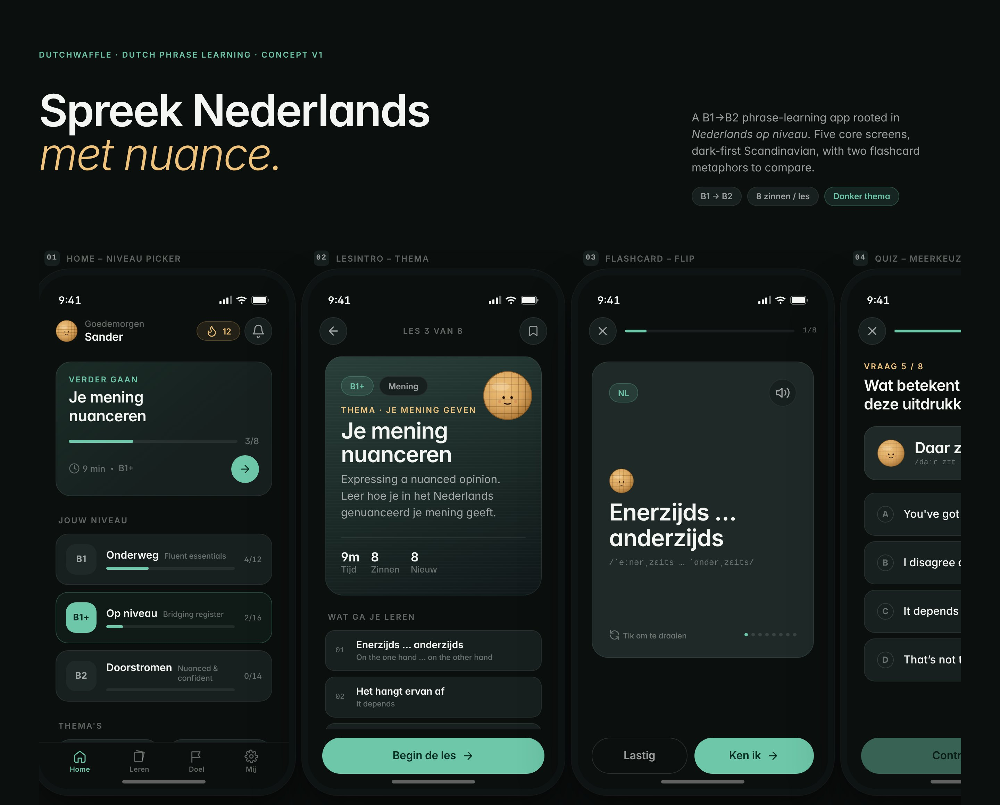
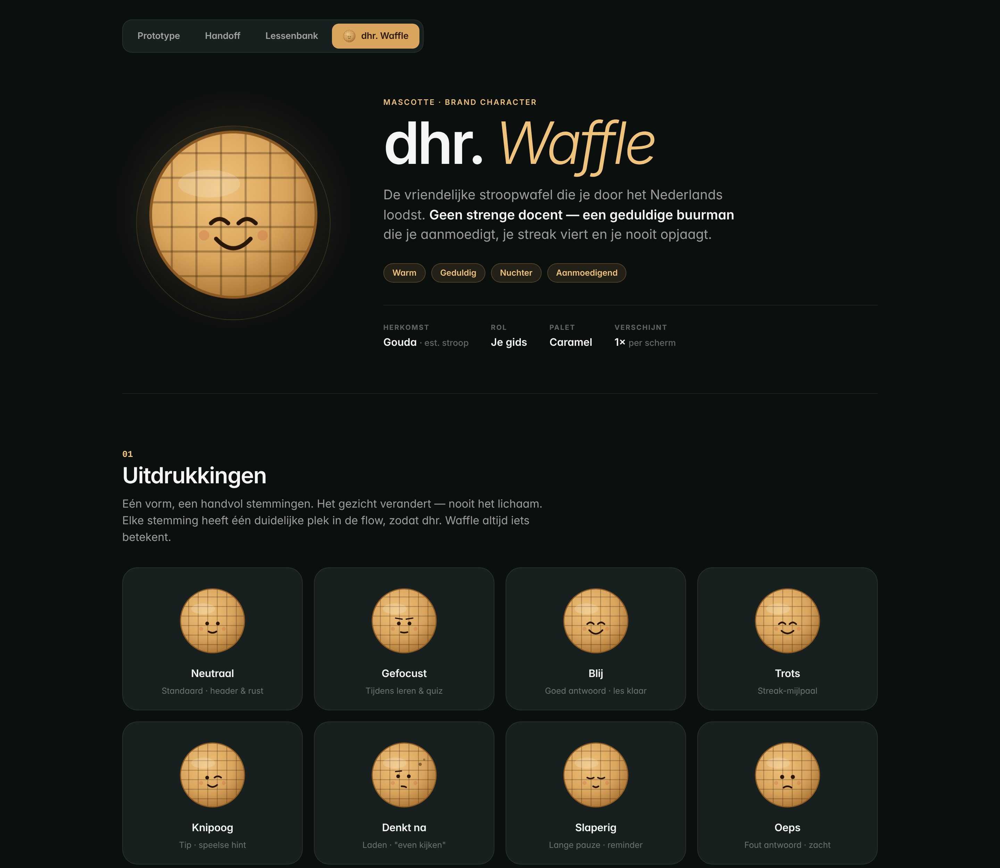
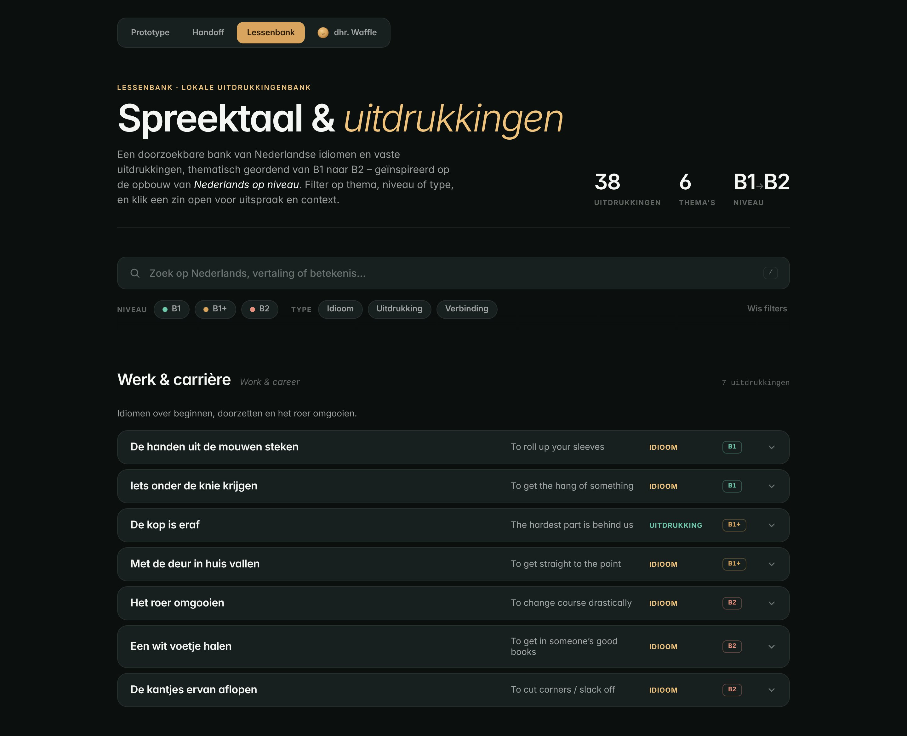
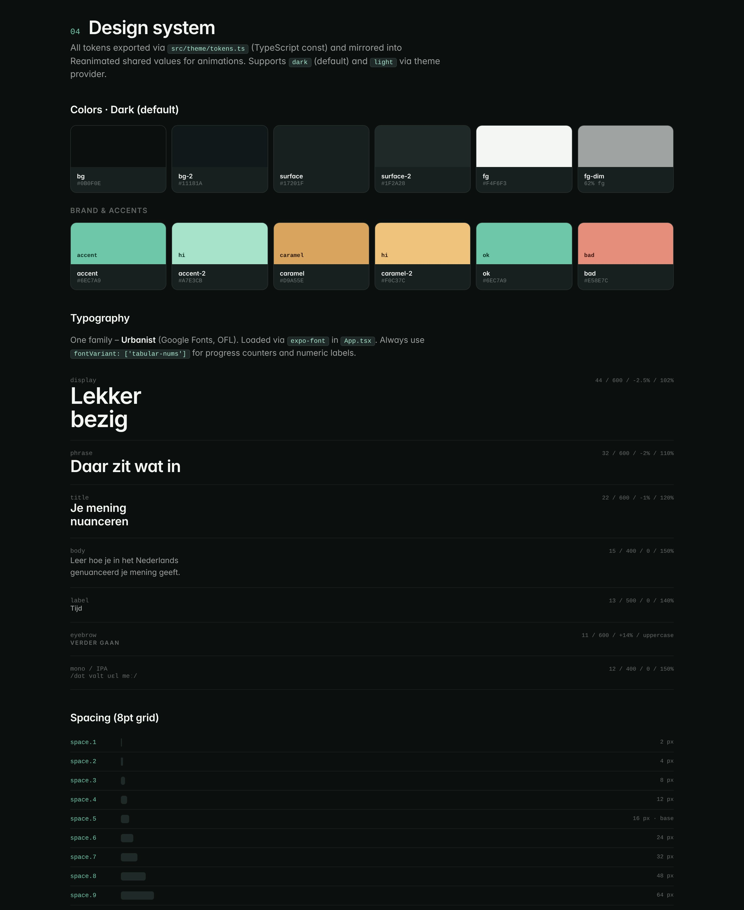
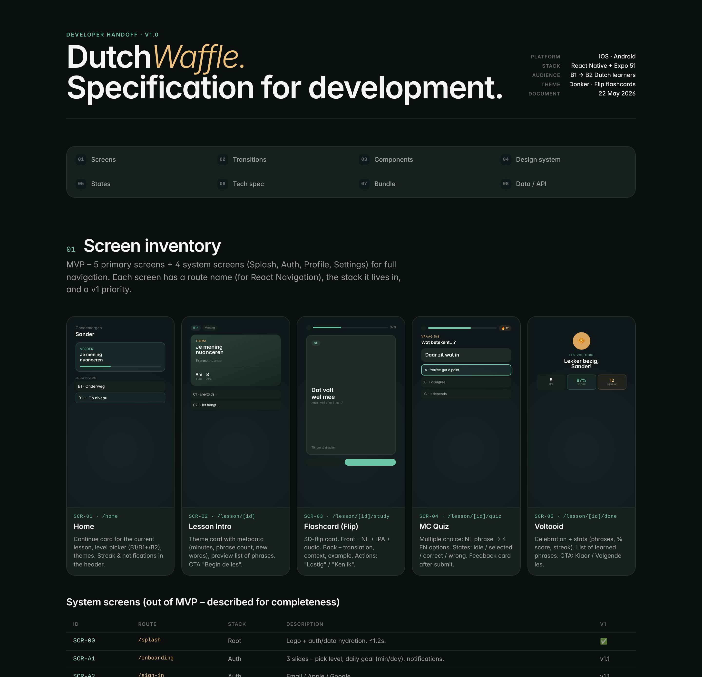

# Wafel – spreek Nederlands met nuance

A mobile app for adults learning Dutch at **B1–B2 level**: the stage where textbooks run out and you need the phrases people actually use at work, with neighbours and in conversations. Short themed lessons, flip flashcards, quick quizzes, and a stroopwafel called **dhr. Waffle** who keeps you company.

**[Try it in the browser](https://bllondis.github.io/DutchWaffle/)** (a phone-sized preview of the mobile app) · **[Design prototype](https://bllondis.github.io/DutchWaffle/design/Dutch%20Phrases%20App.html)** · **[Developer handoff](https://bllondis.github.io/DutchWaffle/design/Handoff.html)** · **[Lesson bank](https://bllondis.github.io/DutchWaffle/design/Lessenbank.html)** · **[Meet dhr. Waffle](https://bllondis.github.io/DutchWaffle/design/dhr.%20Waffle.html)**

Expo · React Native · TypeScript · iOS and Android



> Status: in development. The lesson flow works end to end with locally seeded content; audio and a backend are next.

---

## The idea

Most language apps stop at vocabulary. At B1 the real gap is different: knowing how to *hedge*, *disagree politely* or *nuance an opinion*. Wafel is built around phrases, not words. Each one comes with:

- the Dutch phrase, IPA pronunciation and English meaning
- a usage note explaining *when* to use it
- an example sentence in context

Levels follow the B1 → B2 path: **B1 Onderweg** (fluent essentials), **B1+ Op niveau** (bridging register) and **B2 Doorstromen** (nuanced and confident). The structure is inspired by the B1–B2 course book *Nederlands op niveau*; all example sentences are original.

## Lesson flow

1. **Home** – continue card, level picker, themes, streak
2. **Lesson intro** – theme, level, time and the phrases you'll learn
3. **Flashcards** – 3D flip cards, NL → EN with IPA; mark each phrase *Ken ik* or *Lastig*
4. **Quiz** – multiple choice with instant feedback
5. **Complete** – score, streak and a recap of the phrases

The prototype compares two flashcard metaphors side by side: a **stack**, which shows the next cards behind the current one and keeps momentum, and a **flip**, which hides the meaning until you turn the card and pushes active recall. Flip won for v1.

---

## dhr. Waffle – the mascot



A friendly stroopwafel from Gouda who guides you through Dutch. **Not a strict teacher – a patient neighbour** who encourages you, celebrates your streak and never rushes you.

- **Character:** warm, patient, down-to-earth, encouraging
- **8 expressions:** neutral, focused, happy, proud, wink, thinking, sleepy, oops – each with one clear place in the flow (focused during quizzes, oops on a wrong answer, proud at a streak milestone)
- **Construction:** one perfect circle, a 7×7 waffle grid and a minimal face; fully vector, sharp from an 18 px favicon to a 248 px hero. Only the face changes, never the body
- **Scale with meaning:** 28 px and quiet in the header, 104 px and happy on the completion screen; below 24 px the blush is dropped
- **Restraint:** one dhr. Waffle per screen at most, always round, always caramel, gentle motion only
- **Voice:** short, warm, calm. He praises the work, not the person: *"Lekker bezig."* · *"Geen stress, neem je tijd."* · *"Net niet. Probeer nog eens."*

The full character sheet, with construction specs and do's and don'ts, is in [`docs/design/dhr. Waffle.html`](docs/design/dhr.%20Waffle.html). In code he is the `Stroopwafel` component.

---

## Lesson bank



A searchable local bank of **38 Dutch idioms and expressions** across **6 themes** – work and career, giving opinions, society, education, health, media and news – ordered from B1 to B2.

- Search across Dutch, translation and meaning
- Filter by level (B1, B1+, B2) and type (idiom, expression, connector)
- Open any row for IPA, meaning and an example sentence

The data lives separately in [`docs/design/data/lessons.js`](docs/design/data/lessons.js), so adding a theme or a phrase updates search, filters and counts automatically.

---

## Design system



Dark-first, calm and Scandinavian: a charcoal-green base, one teal accent and a warm caramel borrowed from the stroopwafel. No gradients outside a single lesson-intro card.

- **One token file** – [`src/theme/tokens.ts`](src/theme/tokens.ts), read through `useTheme()`. No colours, spacing or fonts are hardcoded in components
- **Colour** – `bg`, `surface`, `fg` layers plus `accent`, `caramel`, `ok` and `bad`, defined for dark (default) and light
- **Type** – Urbanist only, with named styles: `display`, `phrase`, `title`, `body`, `label`, `eyebrow` and a mono style for IPA; tabular numbers for counters
- **Spacing** – 8pt grid (`space.1`–`space.9`); **radii** from `sm` (10) to `full`
- **Components** – `Button` (primary, ghost, destructive), `Chip`, `ProgressBar`, `TextField`, `Skeleton`, `Stroopwafel`, `FlipCard`, `QuizOption`

---

## From design to code



1. **Designed in Claude Design** – an interactive prototype of the full flow, with live tweaks for theme, flashcard metaphor, font scale and the mascot
2. **Handed off as a spec** – screen inventory with routes, transitions and gestures, component APIs, tokens, states, data contract and acceptance criteria per screen. See [`docs/handoff/HANDOFF.md`](docs/handoff/HANDOFF.md) or the visual version, [`Handoff.html`](docs/design/Handoff.html)
3. **Built with Claude Code** – following the handoff and the rules in [`AGENTS.md`](AGENTS.md), then reviewed and refined by me

I designed the product and directed the build; AI tools wrote much of the code. The project shows how a designer can take an idea from first concept to a working, deployed app.

## Tech

- **Expo** + **Expo Router** (file-based routing, typed routes)
- **React Native** for iOS and Android, with **react-native-web** for a quick browser preview
- **TypeScript**
- **TanStack Query** for data loading, **Zustand** for lesson state
- **Reanimated** + **Gesture Handler** for the flip card, **expo-haptics** for feedback
- **GitHub Actions** – every push to `main` builds the browser preview and publishes it, together with the design pages, to GitHub Pages

```
src/
  app/            screens (Expo Router): index, lesson-intro, flashcard, quiz, complete
  features/lesson api, hooks and components for the lesson flow
  components/     shared UI components, including the Stroopwafel mascot
  theme/          design tokens + ThemeProvider
  data/           types and seeded lesson content
docs/
  design/         prototype, handoff, lesson bank and mascot pages (HTML)
  handoff/        developer handoff: screens, navigation, components, tokens, API, flows, acceptance
  screens/        images used in this README
```

## Run locally

```bash
npm install
npx expo start
```

Then open it in Expo Go, an iOS simulator or an Android emulator, or press `w` for a browser preview.

## Roadmap

- [ ] Audio for every phrase
- [ ] Move the 38 lesson-bank expressions into the app as lessons
- [ ] Spaced repetition for phrases marked *Lastig*
- [ ] Backend and progress saved across devices
- [ ] Onboarding, profile and settings (specified in the handoff, out of scope for v1)

---

Designed and built by [Tetiana Dovgalenko](https://bllondis.github.io/portfolio-site/) – Product Designer & AI Design Engineer, The Hague. [LinkedIn](https://www.linkedin.com/in/tanya-dovgalenko/)
